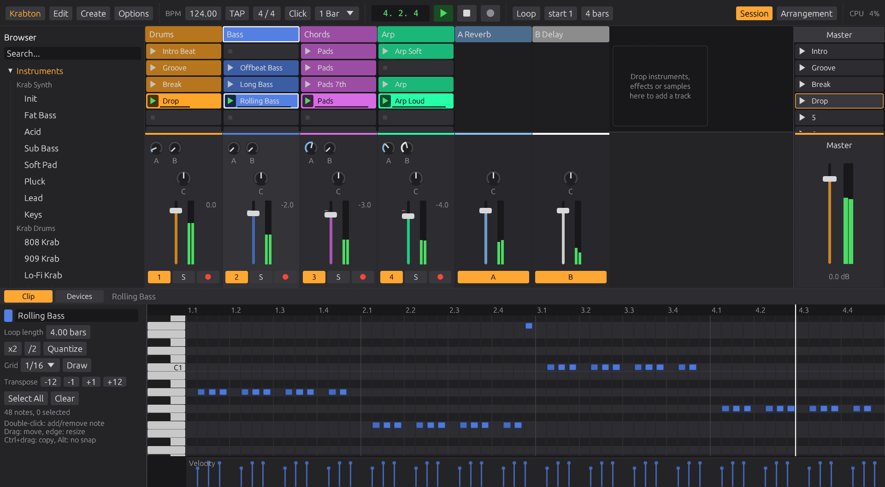

# Krabton

**An open-source, Live-inspired DAW written in Rust.** Session view clip launching, an arrangement timeline, built-in synths, drums, a sampler and effects, all in one native binary with no plugins required.



> Krabton is a hobby project inspired by the workflow of Ableton Live. It is not affiliated with or endorsed by Ableton.

## Install

No programming needed: download the file for your system from the [Releases page](https://github.com/daandobber/krabton/releases).

- **Windows**: `Krabton-Setup-....exe`. Run it and click through (it does not need administrator rights). Krabton appears in the Start menu, and double-clicking a `.krab` set opens it. Windows may warn about an unknown publisher the first time: click *More info*, then *Run anyway*. Prefer no installer? Unzip the portable zip and start `krabton.exe`.
- **Linux**: `Krabton-....AppImage`. Make it executable (right-click > Properties > Allow executing, or `chmod +x Krabton-*.AppImage`) and double-click it. Or unpack the `tar.gz` and run `./install.sh`, which puts Krabton in your applications menu (`./install.sh --uninstall` removes it).
- **Arch Linux**: build the package from source with makepkg:
  ```sh
  git clone https://github.com/daandobber/krabton.git
  cd krabton/packaging/arch && makepkg -si
  ```
- **macOS**: `Krabton-....dmg`. Open it and drag Krabton to Applications. It is not signed by Apple, so the first time right-click Krabton and choose *Open*.
- **Steam Deck**: in Desktop Mode, the Linux AppImage. To start it from Game Mode, add it to Steam (*Add a Non-Steam Game*) and give it the launch option `--big-picture`, so it opens in [Big Picture](#big-picture) with the Deck's controls.
- **Raspberry Pi, ClockworkPi uConsole and DevTerm** (64-bit ARM Linux): `Krabton-....-aarch64.AppImage`, or the `linux-aarch64.tar.gz` (unpack it and run `./install.sh`).

For sound on Linux see [Building](#building) below: Krabton talks to PulseAudio/PipeWire directly, or to ALSA.

## Features

**Big Picture** (for controllers, joysticks and touch screens: a Steam Deck, a ClockworkPi, a tablet)
- A second face for the same Krabton: a few big pages instead of panels, made for a gamepad (Xbox, PlayStation, the Steam Deck's own controls and other pads), the keyboard's arrows or a finger. *Big Picture* at the top right of the desktop view opens it, and so does Start on a controller; *Desktop* goes back. *Start in Big Picture* (in Options, or in its menu) makes it the way Krabton opens, and `--big-picture` or `KRABTON_BIG_PICTURE=1` does it once
- The same buttons everywhere: the D-pad (or the left stick, or the arrow keys) moves the focus, A chooses (Enter), B goes back (Escape), the shoulder buttons turn the pages (Q and E, Tab), the triggers or the right stick turn the value with the focus (or [ and ]), Start plays and stops (Space), View/Select opens the menu (M) and the right stick pressed records (R). The bottom row always shows what the buttons do
- *Clips*: the session grid with big clips; A launches (on an empty slot of a MIDI track it makes a clip and opens it in Notes), X stops the track, the column on the right launches scenes, Y opens what can be done with a slot (edit its notes, record into it, a new clip, duplicate, delete, stop everything). A finger taps clips and drags the grid
- *Notes*: the clip as a grid of steps, folded to the notes of the key (and any pitch that has a note; *Fold* unfolds), a row per pad on a drum track. A puts a note in or takes it out (and you hear it), X and Y make it a step shorter or longer, the triggers set how hard it plays, B goes back to the clips. With a finger: tap or paint notes, drag the note names or the ruler to scroll. On top: play the clip, its length in bars, the grid (1/8, 1/16, 1/32), x2 (doubles the loop with its notes) and Clear
- *Play*: pads for the selected track, eight by four in the key (a fourth up each row, the roots lit) or a pad per drum for a drum track. Play them with as many fingers as the screen takes, or move over them and hold A; the right stick plays the row the cursor is on, the pad it points at (straight left the first, up the middle, straight right the last; a dot on the row shows where): in *Trigger* every new pad plays at once and letting go ends the note, in *Hold* the note rings on until the next pad (or B); L3 switches. X and Y change the octave, the triggers the track, *Rec* records what you play into a new clip. The pads light up with every note the track plays
- The row of modes on Play: *Pads*, *Glide* or *XY* for the sticks, what the triggers do, how far they bend, the range of the rings, *Hold* and *Velocity*. Menu (View/Select) on Play first goes to this row: left and right choose a button, up and down change a value (the bend, the range), A sets it, B goes back to playing; Menu again opens the menu
- *Glide* puts the pads away: each stick sweeps a ring of notes in the key, all the way round, from the bottom (low) over the left, the top and the right (high), one to four octaves (*‹ 2 oct ›*, or the D-pad up and down), the left stick an octave below the right. Every note a stick passes plays, the new note before the old one ends, so a mono synth with glide slides; with *Hold* a note rings on after letting go. With *Velocity* how far a stick is pushed sets how hard each note is struck: a new note waits until the stick stops going out (or reaches the rim, at most 50 ms), so a quick flick plays hard and a gentle push soft, and while gliding every note passed plays as hard as the stick is out. The rings can be touched too, further out harder; left and right on the D-pad change the track. On a drum track the rings hold its drums
- *XY*: the left stick plays the ring, the right stick is a joystick on two knobs: two *Joystick* modulators that move them around where they are set. Krabton picks the most telling two of the instrument (filter and resonance, Timbre and Morph on Plaits, Timbre and Color on Braids, the vowel and the head of the Monk, ...); *X* and *Y* under the pad change them to any knob of the instrument or its effects, the track volume or pan, or nothing
- The triggers on Play: *Track* (change the track), *Bend* (LT bends the notes down, RT up: ±1, 2, 3, 4, 5, 7, 12 or 24 semitones) or *Mod* (the track's mod wheel: a *Mod Wheel* modulator, which Krabton adds and connects to the instrument's most telling knob when the track has none)
- *Devices*: the track's instrument, sequencers, MIDI and audio effects as a list, and every parameter of the chosen one as a big row: left and right step it, the right stick turns it smoothly, a finger drags it, the triggers go to the device before or after; the first row changes the instrument's preset (a drum track's kit). X turns a device on or off, Y adds one
- *Rack*: every track at once, a row per track: first its mixer (volume with its meter, pan, two sends, mute, solo and arm), then a card per device with its live screen (the one it has on the desktop: the monk, the birds, the brook, the chimes, a sequencer's editor, a scope; otherwise its sound and the notes it plays) beside its first four knobs. A goes into a card to turn them (up and down choose, left and right or the triggers turn), X turns a device on or off (on the mixer: mute), Y opens all its knobs on the Devices page (or the Mixer page)
- *Tape*: the four-track tape (see Tape below), with its tricks on the sticks and triggers
- *Mixer*: a strip per track and the master: volume with its meter, pan, the sends, mute, solo and arm
- *Browse*: instruments with their presets, drum kits, sequencers, MIDI and audio effects; A loads one onto the selected track, X onto a new one
- The menu: on Play the track played, tempo, metronome, key and scale, launch quantization, undo and redo, new, open, save, the demo and ambient sets, full screen, and the way back to the desktop
- Sizes follow the screen, from 1280 x 800 (a Steam Deck) down to 1280 x 480 (a DevTerm)

**Tape** (*Tape* next to Session, Arrangement and Rack, and a page in Big Picture)
- A four-track tape of six minutes, recording what you play: arm a track (*Rec*) and while the transport runs it records what the played track plays (or the audio input, or any track: *From*), mixed with what is on the tape already, through a soft tape saturation. The tracks scroll past the playhead in the middle, two reels turning with the tape
- The tape runs at any speed (in semitones, from a quarter to twice as fast, the pitch going with it), backwards (*Reverse*), and loops the bar it is in (*Loop*). Each track has its level and mute
- Edits on a bar (or the loop): *Lift* takes it out, *Drop* puts it back at the start of another bar or track, *Erase* silences it; *Undo* takes back the last take or edit, again redoes it
- Tape tricks on a controller: the right stick scrubs the tape by hand, the left bends its speed, LT brakes it to a stop and RT stutters the bit just played (the harder, the shorter); left and right move a bar, B winds back to the start (of the loop), X reverses, Y loops, A arms. On the desktop: the mouse, the arrow keys, drag the tape
- Saved next to the set as a WAV per track (*<set> Tape 1.wav* ...), loaded with it

**Session view**
- Clip launcher grid with scenes, per-track stop buttons and *Stop All Clips*
- Global launch quantization (none, 1/16 up to 4 bars), blinking queued clips, progress bars
- Drag clips between slots (Ctrl+drag copies), right-click menus, rename, recolor, duplicate
- Mixer under the grid: sends, pan, volume fader with peak meters, track activator, solo, arm
- Two return tracks (A Reverb, B Delay) out of the box, and a master track
- Stop keeps the launched clips, so Play starts them again, as in Live; *Stop All Clips* or a track's stop button clears them
- New tracks are named after their instrument (Analog, Elements, FM, ...), not after the preset; a name you type stays

**Your layout**
- **Rack view** (*Rack* next to Session and Arrangement, Ctrl+Shift+R): every track's devices at once, a row per track (or a column, *Tracks in rows* swaps them), each starting with a mixer strip (volume and meter, pan, sends, activator, solo, arm) and buttons to add a MIDI device, an effect or change the instrument; drag a device's lower edge for its height. Every device keeps moving while it plays (instrument screens, sequencers, displays), not only the selected track's
- Choices (a rate, a mode, a style...) are horizontal sliders: drag left or right through the options, click for the list, double-click for the default
- A track's colour is the accent of everything in it: its devices' knobs and screens, its clip view, its strip in the Rack
- Drag any divider to make things bigger or smaller: the browser's edge, the top of the detail view (devices and clips), the right edge of a track header (track width), the line above the mixer (mixer height), the arrangement's header edge and the bottom of a lane (lane height), the clip view's left column, and the right edge of the big device displays (Lens EQ, Lens Comp, Lens Limiter, Oscilloscope, the sample editor). Dividers light up under the pointer; small dots show where they are
- *Options > Size of everything* (or Ctrl +, Ctrl -, Ctrl 0) makes the whole interface bigger or smaller
- Sizes and zoom are remembered between sessions

**Browser** (laid out like Live's)
- A sidebar with *Collections* (Favorites and six colors), *Categories* (All, Sounds, Drums, Instruments, Audio Effects, MIDI Effects, Plug-ins, Clips, Samples) and *Places* (Music, the current project's folder and folders you add)
- A *Name* list where devices open up into their presets (Analog, Braids, Drums, Elements, FM with its banks, Plaits, Sampler, Synth) and folders on disk into their samples and DX7 banks
- *Sounds* sorts every preset by the kind of sound (Bass, Keys, Lead, Pad, Strings, Mallets & Bells, ...), *Drums* has the kits and the drum hits, *Clips* the clips of this project to copy elsewhere
- Search finds words anywhere in a name or its folders and opens the folders with results; *All* searches everything
- Double-click or Enter loads an item onto the selected track, or drag it onto a track, slot or the arrangement. A device folder loads the device
- Arrow keys browse (Left/Right close and open folders), 1-7 put the selected item in a collection, 0 takes it out of all of them; right-click for the same
- A preview strip shows the selected sample's waveform and plays it (Preview on/off)
- Collections, Places, plug-in folders, FM banks and the grid rotation are kept between sessions in `prefs.json` (`%APPDATA%\Krabton`, `~/Library/Application Support/Krabton` or `~/.config/krabton`)

**Arrangement view**
- One lane per track with mini note/waveform previews
- Move clips and resize them from either edge (clips loop when stretched), with grid snapping (Alt = free)
- Loop brace, click-to-locate ruler, follow playhead, Ctrl+wheel zoom
- *Scenes to Arrangement* turns a session jam into a song
- An **arranger track** (as in Studio One): song sections (Intro, Verse, Chorus...) above the ruler. Double-click to add one; drag a section to move it with all its music (the song closes up behind it and makes room where it lands), Ctrl+drag to copy it, drag its edge to resize; right-click to rename, loop it, duplicate it, recolour it or delete it with or without its music. Clips across a section's edge are cut in two
- Session clips override the arrangement per track, with *Back to Arrangement* like Live

**Editing and recording**
- Piano roll with draw mode, marquee selection, move/resize, Ctrl+drag duplicate, velocity lane, quantize, transpose, x2 / /2, and a *Preview* switch to hear notes while placing and moving them (off by default; the keys on the left always play)
- Drum mode: the piano roll folds to the pads of the drum rack
- Computer MIDI keyboard (A W S E D F T G Y H U J K ..., Z/X octave, C/V velocity) and hardware MIDI input; a hardware keyboard's pitch wheel bends the synths two semitones each way, its mod wheel drives *Mod Wheel* modulators
- Session record: arm a track, press record (F9), play; notes are overdubbed into the looping clip with optional 1/16 quantization
- Undo/redo for every edit, and a **history** window (Edit > History, Ctrl+H, as in Reaper and Bitwig) that names every step ("Edit notes in Pads", "Bass: Lens EQ", "Add section Chorus") and goes back or forward to any of them with a click
- **Note operators** (as in Bitwig) for the selected notes: a *chance* to play each time, *velocity spread*, *repeats* (ratchets) over the note's length, and *recurrence* (play only on chosen loops of a cycle of 2 to 8). The randomness is repeatable, so an export sounds like playback; the piano roll dims notes with a chance, divides repeated ones and labels them
- **Ghost notes**: the piano roll shows the notes of the other melodic tracks that play alongside (the same scene, or overlapping arrangement clips) faintly in their colours (toggle *Ghosts*)
- **Clip envelopes** (as in Live): every clip, MIDI or audio, carries lines that move the mixer (volume, pan, sends), the instrument, the MIDI devices and the effects of its track while it plays. Open *Envelopes* in the clip view, pick a device and a parameter (the ones with a line are red with a ~), then click to add points, drag them, double-click to remove one, or switch on *Draw* and paint the line. The line loops with the clip; modulation adds on top of it
- **Automation Arm** (the zigzag button next to record): while clips play, turning a knob or a fader of their track writes the move into the playing clip, overwriting what was there for as long as you turn; when you let go, the move is thinned out to the points its shape needs. Automated knobs get a red dot, and a red mark on knobs and faders shows where the envelope has them now

**Audio recording and routing** (Live's In/Out section)
- Audio tracks record their input: arm the track and click a slot's record button (it starts and stops on the launch quantization grid, then the new clip plays on), or press Record (F9) to record every armed audio track into the session, or onto the arrangement from the play position in Arrangement view
- An In/Out section under the clip slots of the session view, laid out like Live's: *Audio From* with a second chooser for the input channel or tap point (and an input meter), *Monitor* In/Auto/Off, and *Audio To*. Show or hide it with the I/O button next to Master or Ctrl+Alt+I; when space runs short the mixer turns compact
- *Audio From*: *Ext. In* (channel 1, 2, ... or the pair 1/2, 3/4, ...), another track taken *Pre FX*, *Post FX* or *Post Mixer*, *Resampling* (the master output) or *No Input*. So track 1 can be sent into track 2 and recorded there as audio
- *MIDI From* on MIDI tracks: All Ins, Computer Keyboard, the MIDI device or No Input, and All Channels or one channel; with Monitor In a track always plays what you play, with Auto when it is armed (or selected, if nothing is armed)
- *MIDI From* another MIDI track: the notes that track plays, after its MIDI effects (so a sequencer's notes too), sample-accurate. Layer two instruments on one sequencer, or arm the track and record what the other one plays into a clip
- *Monitor*: In (always hear the input), Auto (while armed and no clip plays) or Off (record without hearing it)
- *Audio To*: the master or another audio track, which then plays it through its own effects and mixer (a bus)
- Right-click a track header and choose *Record into new audio track* for an armed audio track that listens to it, ready to record
- Tracks are processed so that every track comes after the tracks it listens to, which makes track-to-track routing sample exact; routing that would loop back is not offered. Resampling hears the master one block late and is never monitored, so it cannot feed back
- Recordings are WAV files (24-bit) in a *Recorded* folder next to the saved set, or in Documents/Krabton/Recorded for an unsaved one. The audio interface input opens when a track that listens to it is armed or monitoring, at the output's sample rate; input and output on different clocks are kept in step with a small buffer

**Key, scales and MIDI tools** (Live 12 style)
- A project-wide key and scale (18 scales: major/minor modes, harmonic and melodic minor, pentatonics, blues, whole tone, In Sen, Hirajoshi, ...) shown in the transport bar
- Scale mode highlights the scale in the piano roll (root brighter); *Fold* shows only the notes of the scale
- *Convert Project* moves every note of every melodic clip, in the session and the arrangement, to the same scale degree in a new key (A minor's fifth becomes C major's fifth); drum tracks are left alone and Ctrl+Z undoes it
- Scale-aware tools above the piano roll: Snap to scale, move by scale steps, diatonic Chords and 7ths, Arpeggiate (up/down/up-down/random), Strum, Legato, Humanize, and *Seed* to generate a melody in the scale
- Play in key: snap played notes (keyboard and MIDI) to the scale, or let the home row A S D F ... play consecutive scale steps so you can't hit a wrong note

**MIDI effects** (in front of any instrument, including FM and CLAP plugins)
- *Arpeggiator*: Up, Down, Up/Down, Down/Up, Converge, Diverge, Random, As Played and Chord styles; tempo-synced rate (1/32 to 1 bar, triplets), gate, octave range, swing and hold
- *Chord*: one key plays a chord: diatonic triads or sevenths in the project key, major, minor, maj7, min7, dom7, sus2/4, power, octaves, add9 or custom intervals, with inversions
- *Note Length*, *Pitch* (semitones or scale steps), *Scale* (snap or filter, project or custom scale), *Random* (optionally in key), *Velocity* (curve, range, randomize, fixed) and *Note Echo* (tempo-synced MIDI delay with feedback and pitch shift)
- *Strum* (chords played note by note, up, down, alternating or random, with a velocity tilt), *Note Repeat* (held notes roll at 1/32 to 1/4, on the grid, with gate and decay), *Humanize* (loose timing, velocity and swing on the 8ths or 16ths), *Note Filter* (by chance, every Nth note, key range and velocity range), *Mono* (one note at a time: last, lowest or highest, with legato) and *Quantize* (late notes moved onto the grid)
- Chain as many as you like; clips, the arrangement, the computer keyboard and MIDI input all go through them, sample-accurately. Recording keeps the notes you played

**Sequencers** (drop them on any MIDI track, in front of any instrument)
- *Step*: a classic 16-step sequencer with a scale note, velocity, length and ratchets (1-4 hits) per step; forward, backward, ping-pong or random direction, swing
- *Acid*: a TB-303 style bass line: note, octave, accent, slide and tie per step, swing, notes kept in key, optional key transpose (hold a key to move the pattern). Slides overlap the notes so a mono synth with glide really slides. *Generate* writes a new line
- *Drum Grid*: an x0x drum machine: 8 lanes by 16 steps with accents, swing and per-lane notes (GM by default), plus classic patterns (four on the floor, breakbeat, electro, boom bap, half time)
- *Progression*: up to 8 chords in the project key (roman numerals, triads, 7ths, sus, power, add9, 9th, inversions) with rhythms from held chords to stabs, Charleston and arpeggios, plus well-known progressions
- And the generative ones:
  - *Polymeter*: a Kria-style step sequencer with five lanes (trigger, scale note, octave, length, probability), each with its own loop length and clock division, so patterns drift against each other
  - *Euclid*: four euclidean rhythm rings (steps, pulses, rotation, note), drawn as circles. Made for drums
  - *Turing Machine*: a looping shift register that slowly mutates into new melodies; lock it when you like what you hear
  - *Life*: Conway's Game of Life on a 16x8 board, played column by column. Draw the seed, watch it evolve
  - *Bounce*: up to 8 bouncing balls that play a note on every floor hit, speeding up as they lose energy. Each ball has its own note and drop height (from a 16th to two bars: drag them in the editor), hits can snap to a grid, and balls that come to rest drop again on the next beat or bar
  - *Drunk*: a random walk through the scale
  - *Orbits*: up to 8 planets circling at their own speeds; each pass plays its note. Polyrhythms (4 against 3 against 5...) that always meet again on the downbeat
  - *Chaos*: the logistic map as a melody. One knob takes it from a steady note through cycles of 2, 4 and 8 into chaos, drawn as the bifurcation diagram you drag along
  - *Automaton*: a one-dimensional cellular automaton (rules 30, 90, 110 and all 256 others); click the rule's pictures to change it, watch the generations scroll
  - *Ant*: Langton's ant on an 8x8 board (up to three ants), playing the cells it walks over
  - *Pong*: balls bouncing in a box; every wall has its note
  - *Markov*: a melody from chances: repeat, step, leap or rest, leaning up or down, with accents
  - *Rain*: drops at random times and pitches, in drizzles and swelling storms
  - *Words*: type text and it plays: each letter a note (vowels accented), or the whole text as Morse code
  - *Lorenz*: the Lorenz attractor's butterfly, its wings as the melody and rests below a line you drag
  - *Guitar Chords*: a chord progression in the key, played as a guitarist plays it: every chord gets a real chord shape (open chords like x32010 and 320003, barre chords like 133211, or high up the neck; power chords on three strings), each card shows its diagram. A strum pattern of sixteenths plays it: down strokes sweep the strings low to high, up strokes catch the top four from the high string down, soft strokes, muted chucks and reggae chops, or picking: bass, alternating bass, pinches and single strings for Travis picking and arpeggios. Strum time, swing, let ring, humanize; patterns (Old Faithful, Rock, Ballad, Reggae, Funk, Gallop, Travis Picking, Arpeggio...) and progressions to start from. Made for the Guitar, and it strums a piano or a pad just as well
  - *Drummer*: a drummer who plays styles: pick one of 27 (Rock, Pop, Half Time, Punk, Metal, Shuffle, Synth Pop, Funk, Disco, Motown, Boom Bap, Lo-Fi, Trap, House, Techno, Electro, Drum & Bass, Breakbeat, 2-Step, Dubstep, Reggae, Bossa Nova, Samba, Afrobeat, Reggaeton, Jazz Swing, Jazz Ballad) and edit its groove of two bars in fourteen lanes (kick, snare, side stick, clap, closed, pedal and open hat, ride, crash, three toms, tambourine, cowbell), every step a hit, an accent, a ghost note or a roll. On top it plays like a drummer: *Complexity* adds ghost notes, sixteenth hats and kick pickups; *Energy* sets the dynamics and moves to the side stick when low and to the ride when high; a fill every 2, 4 or 8 bars (down the toms, snare builds and rolls, depending on the style) with a crash after it; *Swing* on sixteenths or eighths (shuffle); *Humanize* loosens the hands more than the feet and lays the backbeat back a little. It plays the kit on its track: a lane whose drum the kit lacks takes the nearest it has (a ride becomes a closed hat), and the editor says so. *Vary B* makes bar B a variation of bar A; *Rate* plays the groove in sixteenths, or thirty-seconds for double time, eighths for half time (triplets too)
- And the rhythm generators (in the menu with Euclid, under *Rhythm*):
  - *Drum Map*: a topographic drum sequencer. A map of 25 grooves of its own, from straight (left) to broken (right) and from laid back (bottom) to driving (top): Half Time, Boom Bap, One Drop, Trap and Half Step at the bottom, then Rock, Hip Hop, Bossa, Two Step, Breakbeat; House, Funk, Afrobeat, Electro, Jungle; Techno, Motorik, Samba, Dembow, Footwork; and Hard Techno, Punk, Gallop, Drum & Bass and Breakcore at the top. Every step of kick, snare and hats has a weight (how much it belongs to the groove), and between the grooves the weights blend, so dragging across the map morphs one into the next. A *Fill* per drum plays what weighs enough: low only the backbone, high every ghost note; *Chaos* shakes the weights anew every two bars; the weight sets how hard a step is hit (*Dynamics*), a strong hat on an off-beat opens, and *Swing*. Its screen is the map and the two bars it plays, every step's weight a bar and each fill a line you drag. Plays any kit (a drum the kit lacks takes the nearest it has). The idea is that of topographic drum sequencers; the map is Krabton's own
  - *Marbles*: a random sampler, a port of Mutable Instruments Marbles' T and X generators. T2 is a clock (any note value, loosened by *Jitter* that always finds its way back), T1 and T3 are dice thrown on its ticks by one of seven models: a coin toss between them, clusters, drum patterns, two independent coins, a divider (from 8:1 to 1:8, polyrhythms like 3:2 and 5:4 between), three states and a Markov chain that likes to echo itself; *Bias* leans towards T1 or T3, *Gate* and *Gate Random* set how long they last. The X section draws three random values from a distribution (*Spread* from always the same through bell curves to a coin, *Bias* where it leans; *Identical*, *Bump* or *Tilt* across the three) and *Steps* quantizes them to the project's scale with fewer notes as you turn it (all twelve, the scale, its triad, fifth and root, the root). *Déjà Vu* makes the dice remember: at noon a loop of *Length* throws (1 to 16) repeats exactly, to the left it slowly takes in new ones, to the right it jumps around inside; T and X each loop or not. As *Drums* T1, T2 and T3 play three drums and the X values their dynamics; as *Notes* each T plays its X value. Its screen shows the last sixteen ticks of each T with the déjà vu loop, and the distribution with three marbles where they fell (drag to set Bias and Spread)
  - *Chance*: a drum grid of chances and conditions. Eight lanes of up to sixteen steps, each lane its own length (so they drift against each other); every step is off, a hit or an accent, with a chance to play, a condition (1:2, 2:2 up to 4:4: the A-th of every B times round; Fill or Not Fill; First or Not First; Pre or Not Pre: if this lane's last condition came true; Nei or Not Nei: if the lane above's did) and a ratchet of one to four hits. A fill every 2, 4 or 8 bars or when you press *Fill*; *Chance* scales every step's chance at once. The grid shows a step's chance as how much of it is filled, its condition on it and its ratchet as dots, and lights a step red when it was skipped. Right-click a step for its chance, condition and ratchet, scroll over it for its chance; patterns to start from (Probable House, Breaks and Fills, Drifting Hats)
  - *Bits*: rhythms from bytebeat formulas. A counter goes up a step at a time, a formula of it (t, t*a, t*(t>>a), t^(t>>a), t*(t>>a|t>>b), t&t>>a and more) gives a byte, and four drums each listen to one of its bits: they play where it is on (*Level*) or where it turns on (*Edge*), as hard as the bits above say (*Dynamics*). *Loop* keeps it to 1 to 8 bars, *Seed* starts the counter elsewhere. Its screen is the byte step by step with each drum's bit in its colour; click a row to give it to a drum
  - *Percussion*: a percussion ensemble. Pick a style (Son Montuno, Guaguanco, Bossa Nova, Samba, Baiao, Cumbia, Bembe in 6/8) and its players lock in around the timeline (the clave or the bell): shakers, congas with open, muted and low tones, bongos, a low drum, a guiro, a triangle, agogo... *Density* brings them in one by one, the *Lead* drum improvises (licks as *Variation* rises and a call at the end of every four bars; in son the bongo player leaves the martillo for it), the others now and then drop a note or add a ghost one, *Humanize* loosens them, *Swing* swings the sixteenths and *Speed* plays it at half or double time. It plays the kit's percussion (a new track gets the 808 Latin kit) and takes the nearest drum the kit has for one it lacks
- And the ones you play into:
  - *Spinner*: every key you play drops a ball into a turning polygon; each time a ball hits a wall it plays its note, as hard as it hit. *Spin* (either way), *Sides* (three to eight), *Gravity*, *Bounce* and *Size* shape the machine; without *Keep* a ball leaves when its key is let go. Its editor shows the polygon turning and the balls in it
  - *Endless*: with *Record* on, every note you play (the keys, a MIDI keyboard, the Big Picture pads) is added to a row of up to 64 steps, *Rest* adds a rest, *Back* takes a step off, *Clear* starts again; with it off the row plays round and round at its *Rate* and a key you hold moves it there, from its first note
  - *Hands*: hold keys and each plays a rhythm (Four, Offbeat, Eighths, Sixteenths, Clave, Tresillo, Gallop, Sparse): one *Pattern* for all, or *Per Key* a pattern of its own, so on a drum kit your fingers play a groove. *Accent* marks the strong steps
  - *Draw*: a line drawn with the mouse (or a finger) across 32 steps, played in the key over a *Range* of one to four octaves from the *Base Note*, every step or only where the line moves (*On Change*: a note lasts until it does)
- And the ambient ones, for drones and slow music:
  - *Loops*: up to 7 notes on their own long loops (17, 21, 25... beats) that drift in and out of phase like tape loops, so the chords never repeat. Drawn as rings; a dice rolls new notes and lengths
  - *Bloom*: like Eno's Bloom: click the pond to drop a note (the higher you click, the higher the note) and it ripples out again with every echo, sometimes wandering a step. In *Loop* your notes stay on the pond as dots and keep coming round in their place in the bar, after a stop, a jump or reopening the set (click a dot to take it away, or clear them all); in *Fade Away* they echo softer and softer until they are gone. Left alone for two bars it blooms by itself, around the notes you dropped. It plays with the transport stopped too, and on the grid a pad drops a note
  - *Chimes*: wind chimes, simulated: the wind pushes the sail, the clapper swings and a note sounds whenever it meets a tube (tubes in a pentatonic set of the scale). Spacing, clapper and sail change how often and how hard; the screen draws the simulation, so what you see is what you hear. Drag for the wind. The Wind Chimes instrument does the same with its own tube sounds
  - *Drift Chords*: slowly changing chords where one voice at a time moves a step and the rest are held (legato or struck again)
  - *Tintinnabuli*: a stepwise melody paired with a voice on the nearest note of the tonic triad (above, below or alternating), over a held tonic
  - *Pedal*: a held drone note (with its octave and fifth if you like) that now and then moves to the fifth, fourth or octave and back
- They follow the transport, play in the project key and feed the rest of the chain: put an Arpeggiator or Chord after a Turing Machine. Stopping or bypassing one never leaves notes hanging
- *Transpose* on any of them: the notes you play (keyboard, MIDI, the grid, a clip) move the pattern instead of sounding, from its base note, in scale steps when the project's scale is on. With *Hold* the last key stays, without it only while held

**Modulation matrix** (something Live doesn't have)
- Project-wide modulators: *LFO* (7 shapes, free or tempo-synced), *Envelope* (ADSR triggered by a track's notes, after its MIDI effects, so sequencers can fire it), *Follower* (follows a track's loudness: sidechain ducking in two clicks), *Steps* (a drawn step sequence), *Macro* (one knob for many), *Notes* (velocity, pitch, gate or a random value per note) the modifiers *Math* (add, multiply, min, max, compare two inputs) and *Shaper* (gain, offset, curve, quantize, slew, invert, rectify), and *Tides*, a port of the Mutable Instruments Tides tidal modulator: a slope that loops with the tempo (or freely, in Hz) or rises and falls on a track's notes (*AD* once per note, *AR* up while held, down when let go), with *Shape* bending its curves (log, sine, linear, exponential...), *Slope* moving its peak, *Smoothness* rounding it off to the left and folding it to the right, and four outputs whose relation *Shift* sets: *Gates* (the slope, a plain ramp, end of attack, end of release), *Amplitude* (the slope moving from output to output), *Phase* (four phases) and *Frequency* (four at ratios from subharmonics to chords, always in step). Each Tides sends one of its outputs (*Out*); its panel draws a cycle of all four. *Mod Wheel* follows a track's mod wheel: a MIDI keyboard's (CC 1), or the triggers in Big Picture; *Joystick* one way (X or Y) of the right stick in Big Picture's XY mode, -1 to 1 around the knob
- Connect anything to anything: instrument, audio effect and MIDI effect parameters on any track, return or the master, plus volume, pan and sends. Modulators can modulate each other (an envelope that speeds up an LFO, an LFO multiplied by a follower, ...)
- Three ways to connect: drag a modulator chip from the device view onto a knob, press *Map* and click or drag knobs (drag sets the amount), or click a cell in the matrix (rows are sources, columns are targets; drag to set the amount, right-click for invert and more)
- Modulated knobs show a ring per connection in the modulator's color and a dot that moves with the live value; the Mod tab has a scope per modulator
- Runs inside the audio engine at control rate (every 64 samples, about 1.3 ms), so it is also in *Export Audio*

**monome grid and arc** (native serialosc support, and grids straight over USB serial)
- Plug in a grid and Krabton finds it: through serialosc, or, for grids serialosc does not see (newer and DIY grids that are plain USB serial devices), directly on their serial port with monome's serial protocol. The Grid tab shows which grid is connected and where, and *Rescan* looks again Three modes: *Session* (launch clips and scenes, stop tracks), *Keys* (an in-key isomorphic keyboard, rows a fourth apart) and *Sequencer* (edit the selected track's sequencer on the grid: draw Life seeds, edit Polymeter lanes, set euclidean pulses, ...)
- An arc controls the first four parameters of the selected track's first MIDI device, or volume, pan and sends; with the Mod tab open it plays the selected modulator
- No grid? The *Grid* tab in the detail view has an on-screen grid that runs the same logic with the mouse
- *Rotation* turns the grid (0 or 180 degrees, and 90 or 270 for square grids) when its cable points the other way; keys and LEDs follow
- Varibright LEDs, 8x8, 16x8 and 16x16 grids. Tested against a simulated serialosc and a DIY 16x8 grid over USB serial

**Instruments**
- Many have a screen in the spirit of hardware synths, showing what the sound does: the grains of Particles flying around a jar and lighting up on every collision, the Organ's drawbars (drag them) and rotating speaker (click it), vibrating strings for Rings and Strings, Elements' exciters feeding its resonator, a little choir for Voice (as many singers as it has, their mouths making the vowel as it morphs, monks in robes when they chant an undertone, a whistling line for the overtone), bars for Mallets showing the stick's hardness and where it lands, the vibrato fans and the bar that is struck, and a tube with breath for Winds
- Analog and Synth have small screens next to their own knobs: each oscillator's wave and the mix, the filter's curve (moving with the envelope), the envelopes with every voice running along them (drag the handles) and the LFO
- **Analog**: a classic analog polysynth, see below
- **Modular**: a eurorack-style modular synth in its own rack window (*Open Rack*). Modules sit in 104 HP rows and are patched by dragging cables from jack to jack (drag an input's cable to move it, right-click a jack to unplug it, drag a module by its name to move it). Real eurorack voltages: 1 V/oct (0 V is C4), 10 V gates, ±5 V audio and LFOs, 0-10 V envelopes. 48 modules:
  - *Sources*: VCO (sine, triangle, saw, square, PWM, linear FM, hard sync), Macro VCO (24 synthesis models: virtual analog, FM, formants, chords, speech, strings, modal, drums; with its low-pass gate), Shape VCO (47 digital shapes), Resonator (modal, sympathetic and inharmonic strings, FM voice, chords; struck or fed audio), Pluck (Karplus-Strong string), Noise (white, pink, drift)
  - *Drums*: Bass Drum, Snare Drum, Hi-Hat
  - *Filters & Amps*: VCF (multimode state-variable), Ladder, Formant (vowel filter), VCA, Quad VCA, Folder (wavefolder), Ring Mod, Meta Mod (crossfade, fold, analog and digital ring, XOR, compare, morphing)
  - *Envelopes & LFOs*: ADSR, AD, Function (rise and fall with a curve, triggered or cycling), LFO
  - *Sequencing*: Clock (in time with the song, swing, divisions, bar reset), Sequencer (8 steps), Trigger Seq (16 steps), Euclid, Random (random gates and voltages with bias, spread, steps and deja vu), Shift Register (a looping, slowly changing random sequence), Burst (ratchets), Switch (sequential), Quantizer, Divider, Chance (Bernoulli gate)
  - *Utilities*: S&H, Mixer, Stereo Mixer (level and pan), Atten (attenuverter and offset), Slew, Transpose, Logic (min, max, rectify, compare), Follower (envelope follower), Pulse (trigger to gate, with delay)
  - *Effects & I/O*: Delay, Reverb, Texture (granular: grains, time stretch, looping delay, spectral), Crusher, MIDI-CV (your notes as pitch, gate, velocity and trigger), Macros (eight knobs you can modulate and automate from Krabton) and Audio Out
  - Mono (legato, with clocks and drones running free) or up to 8 voices, each running its own copy of the patch. Patches: Init, Acid Bass, Fat Lead, West Coast, FM Bell, Drone, Generative, Kick, Poly Pluck, Drum Machine (plays by itself), Macro Voice, Texture Pad, Pluck Melody, Struck Resonator
- **Organ**: a tonewheel organ with nine drawbars (the top wheels fold back), single-triggered percussion on the second or third harmonic (fast or slow, soft or normal), key click, the scanner vibrato and chorus (V1-V3, C1-C3), a tube-style drive and a rotating speaker (slow, fast, with inertia). Registrations from Jazz Trio, Green Onions and Gospel to Whiter Shade, Reggae Bubble and Cathedral
- **Winds**, **Strings** and **Mallets**: physical models from the Synthesis ToolKit, each with a model choice and that model's own controls (named after it), polyphonic. Winds: flute, clarinet, saxophone, brass, blown bottle, blow hole and whistle (breath pressure, reed, noise, vibrato). Strings: bowed (bow pressure, position and speed), plucked, mandolin (body, pluck position, detuning), sitar and stiff string. Mallets: marimba, vibraphone, agogo, two woods, reso, beats, two fixed, clump, and the banded waveguides: uniform and tuned bar, glass harmonica and Tibetan bowl
- **Voice**: a singing voice. A band-limited glottal source (Brightness) and Breath go through four formant filters set from the Synthesis ToolKit's 32 vowels and consonants; morph between two vowels by hand or with a slow LFO, and shift the formants from child to giant. Glide (legato with one voice), Attack, Release and Octave; a choir of up to four detuned singers per note spread across the stereo field; vibrato with a delay, and drift. Chant: *Undertone* makes every other glottal pulse louder so a voice an octave down growls along (Tibetan chant), *Overtone* sings one harmonic out as a whistle and sweeps it (Tuvan throat singing). Presets from Ahh, Ooo and Whisper to Choir Aah, Gregorian, Monk Chant, Om Drone, Throat Singer, Overtone Choir, Soprano, Giant, Legato Lead and Robot Vowels
- **Grand Piano**: a concert grand: the Salamander Grand Piano by Alexander Holm, a Yamaha C5 recorded in 16 velocity layers, downloaded and prepared once from the device (750 MB download, 1.3 GB on disk; Krabton keeps it memory-mapped, reading ahead of every note). Played as its SFZ does: velocity tracking (*Dynamics*), a key struck again damps its old sound, dampers fall on release (the top keys have none), and on release the key and damper noise and the strings' resonance sound, softer the longer the key was held. Notes start where the hammer hits the string, so they answer at once; *Action* brings back the sound of the key going down before it. The sustain pedal comes from your keyboard (MIDI CC 64) or the *Sustain* switch, with its own noise. *Una Corda*, *Lid* and *Tone*, stereo *Width*, the player's or the audience's *Side*, a *Room* (hall), *Natural* or *Retuned* tuning, *Fine*, *Transpose*. Its screen shows the piano from above: the strings shine while they sound, the dampers lift with the pedal or a held key, and the pedals can be clicked. Presets: Concert Grand, Studio Close, Concert Hall, Intimate, Felt Piano, Pedal Down, Pop Piano, Audience Seat
- **Monk**: a chanting monk made of FOF grains (formant wave functions, after Xavier Rodet at IRCAM), ported from MonkSynth: every pitch period a grain of three damped formant sines and breath, its pitch quantized to 1/32 semitone for the character. Vowel (u, o, a, e, i on one knob) and Head (from a big baritone to a small soprano), drawn as a monk you play by dragging in his screen; Glide with a note stack, vibrato with a wandering rate, ADSR, up to ten detuned singers with their heads spread, and a stereo echo. Krabton adds Voices (a choir per note for chords), Octave, Wobble (a vowel LFO) and Velocity. Presets: MonkSynth's Rabten, Dorje, Jamyang, Monastery, Ngawang and Tinley, plus Choir of Monks, Om, Wah Monk, Bass Monk and High Monk
- **Bassline**: acid. A port of Open303 by Robin Schmidt: the saw-to-square oscillator from band-limited tables, the four-pole filter with the high-pass in its feedback loop that makes it squelch, the filter envelope through its normal and accent paths, oscillator and filter at four times the sample rate. Accent comes from velocity (100 and up, or where you set *Accent At*) and slide from playing legato, so the Acid sequencer plays it the way it should. Krabton adds *Drive*. Its screen draws the filter curve following the envelope, with accent and slide lights; drag it for cutoff and resonance. Presets: Classic, Squelch, Rubber, Screamer, Square Bass, Deep Sub, Talking, Hard Acid
- **Mono**: the small mono of the early eighties, with a front panel of sliders and switches like the original. One oscillator: a saw core, a pulse from its comparator (width by hand, by the LFO or by the envelope) and a sub oscillator from flip-flops (an octave down, two octaves down, or a narrow pulse two octaves down), plus noise, into a source mixer; a four-pole ladder that self-oscillates (zero-delay feedback, saturating input), with envelope, LFO and keyboard follow; one envelope, the amplifier on the envelope or on the gate (the classic bass: VCA on Gate, the envelope on the filter); the envelope triggered by gate and every key, by the gate only (legato notes keep it going) or by the LFO; LFO triangle, square, random or noise, with key sync; portamento off, on legato (Auto) or always; velocity and a little vintage drift. Band-limited throughout (PolyBLEP, also on the sub's flips). Behaviour and presets after HUSH ONE by Charles Vestal (MIT)
- **Drone**: a drone that keeps moving for minutes. Four layers with their own levels: a *Tanpura* (four plucked strings in the slow classic cycle, Karplus-Strong strings with a buzzing jawari bridge), a *Pad* (Paul Nasca's PADsynth: every harmonic a band of noise, wider with Bandwidth), *Swell* (pairs of detuned sines that phase-modulate each other and swell and fade on their own) and *Air* (wind through wandering resonant filters on the harmonics). *Evolve* lets pitch, brightness and the balance drift by themselves, *Space* is the Hall. Its screen shows the tanpura strings shivering, the pad glowing, the swells breathing and the air drifting by. Presets from Tanpura and Raga Morning to Deep Space, Organ Drone, Choir of Ghosts, Swell Field, Wind Over Water, Dark Matter and Shimmer Fields
- **Waves**: a wavetable synth on the Adventure Kid Waveforms: 128 single-cycle waves in 16 banks of 8 (Basic, Bright Saws, Vocal, Strings, Keys, Organ, FM, Bells, Chip, Guitar, Reed, Flute, Granular, Hand Drawn, Birds, Raw). Two oscillators morph through their bank (*Position*), with up to seven unison voices, a warp (Sync, Bend, Mirror, Quantize), a sub and noise, a filter with its own envelope, an amp envelope and an LFO on position, pitch and cutoff. Every wave is band-limited per octave, so high notes stay clean. Its screen stacks each bank's waves with the one playing now drawn bright; drag a stack to move through it
- **Guitar**: a six-string guitar: digital waveguide strings (two polarisations each, dispersion of a stiff string, a pluck shaped by pick position and hardness), placed on the strings and frets a guitarist would use, chords strummed down, up or alternating with a little human timing. Lifting a key damps the string; Let Ring, Palm Mute, Slide (with a slide player's vibrato), Capo and five tunings (Standard, Drop D, DADGAD, Open G, Open D). Steel and nylon acoustics with their bodies, or electrics through a single-coil or humbucker pickup at the neck, middle or bridge: put the Pedals after it. Its screen is the neck with the fingers on it and the strings shivering
- **Wind Chimes**: a wind chime that plays by itself, simulated: the wind (in gusts, from a wandering direction) pushes the sail, the clapper swings on its string, the tubes swing on theirs, and every time the clapper meets a tube that tube rings, as hard as they met. A tube sounds with the modes of a free bar, the lowest split into a slow beat as on real tubes, plus the clapper's knock. Aluminium, brass, steel, bamboo, glass or wood; 3 to 8 tubes in nine tunings (pentatonic, chords, whole tone, In, the harmonic series); spacing, clapper weight, sail size and tube thickness change both what you see and what you hear. Its screen draws the simulation itself, so every strike you hear is the clapper touching a tube you see. It blows while the song plays (or always, or while a key is held); a key touches the nearest tube. Presets: Garden Aluminium, Temple Brass, Deep Steel, Bamboo Grove, Glass Porch, Wooden Clatter, Storm, Still Evening, Harmonic Tower
- **Birds**: songbirds that sing by themselves, made from scratch: thirty species, from blackbird, robin, song thrush, nightingale, wren, chaffinch, great tit, blackcap, chiffchaff, willow warbler, yellowhammer, skylark, sparrow and golden oriole to cuckoo, wood pigeon, collared and mourning dove, tawny owl, crow, curlew, swift, loon, gull, a drumming woodpecker, the hermit and wood thrush, the cardinal, a bellbird and a kookaburra; up to four of each of three kinds, every bird with a voice and pace of its own. They take turns as real birds do (more at once the busier they are) and do not all start together. A song is built from syllables the way birds sing them (whistles that glide and bend, trills, harsh chirps full of harmonics, breathy hoots); every bird has its own repertoire and repeats a song type a while before it takes another, as real birds do, and sometimes flies to another branch. Each has its place left or right and near or far (far birds softer, duller and wetter). Busy, Variety, Tempo and Pitch shape the songs; a key makes the bird with the nearest voice sing at once, and Follow Key moves its song onto the key. Its screen is a sonogram of what they sing above the birds on their branches. Presets: Garden Morning, Dawn Chorus, Woodland, Woodland Edge, Nightingale Night, Meadow, Moorland, Lake at Dusk, Seaside, Village, Summer Evening, Lone Blackbird, Owl and Cuckoo, Hermit Thrush Forest, Bellbird Valley, Outback
- **Nature**: the sounds of outside, made from scratch: wind in gusts (a slow and a quick restless part, a little different left and right) that whistles and rustles the leaves; rain drop by drop on leaves, water (drops that trap air ring as bubbles rising in pitch), a roof or a tent; thunder rolling in after the lightning, later the further away it is; a brook of bubbles and gurgling; the sea, wave after wave building, breaking and washing out; crickets that chirp faster when it is warmer (Dolbear's law); frogs; a crackling campfire. Play keys and the wind whistles on those notes. Its screen is a landscape that moves with all of it. Presets: Breeze, Windy Hill, Singing Wind, Gentle Rain, Rain on the Roof, Tent in the Rain, Storm, Brook, Ocean Shore, Summer Night, Pond at Night, Campfire
- **Pan Flute**: blown pipes: pan flute (closed pipes, so odd harmonics only), shakuhachi, ocarina, bamboo flute and wooden flute. The breath rings in the pipe at its resonances, a note starts with a chiff (a puff and a flash of the overblown harmonic) and may scoop up into its pitch, vibrato comes in after a while (more loudness for a pan flute, more pitch for a shakuhachi); one voice plays legato with glide, up to eight play chords. Its screen shows the pipes (or the flute and its holes) lighting up as they sound. Presets: Andes Pan Flute, Romanian Pan Flute, Zen Shakuhachi, Shakuhachi Breath, Ocarina, Bansuri Evening, Canyon Flute, Bamboo Grove, Breathy Pad
- **Facet**: one synth, six engines, each played with four knobs in four colours (named for what they do on the engine) and sharing an envelope, a play mode (poly, mono, legato), glide, octave and velocity. *Crease*: phase distortion, a cosine read at a bent pace turned into a saw, square, pulse, hollow or resonant wave (Wave), how far (Bend), each note starting brighter (Bend Env), a second line beside the first (Detune). *Swarm*: seven saws fanned out (Spread) and wandering (Drift), turned hollow (Shape), through a filter that follows the keys (Tone), across the stereo field. *Fold*: a sine frequency modulated (Ratio, Index) and folded back on itself (Fold, Symmetry). *Grit*: a random stepped wave made per note (Steps), pitched noise in its steps (Noise), crushed in rate and bits (Crush), changing as it plays (Mutate). *Partials*: twelve harmonics from dark to bright (Tilt), odd against even, stretched into bells (Stretch), each swelling on its own (Shimmer). *Wide*: two pulses (Detune, Width) through a filter (Tone) and a wide chorus (Chorus). Its screen draws the cycle the knobs make, with the sound behind it; click the engine's name for the next. Presets: Crease Keys, Crease Brass, Crease Reso Bass, Swarm Lead, Swarm Pad, Hollow Swarm, Fold Bell, Fold Growl, Grit Chip, Grit Machine, Partials Organ, Partials Bells, Wide Strings, Wide Pulse Bass
- **Beads**: the wavetable synth of Mutable Instruments Beads, played with keys (a port, see Beads under the effects): twelve banks of sixteen waves (sines, triangle stacks, drawbars, triangle to saw, bursts and formants, voices, digital and metal, Braids, and four FM banks). The key sets the pitch and holding it seeds grains of the waves as Density says (or they keep coming, or follow the song's clock); each grain's wave, size, shape and pitch can be randomized. The oscillator sounds while a key is held (Attack, Release), the grains and the reverb ring on; Grains sets how much of each; the four qualities lower the bit depth. Its screen draws the wave playing and every grain as a bead. Presets: Sine Sparkle, Glass Pad, Organ Grains, Choir Dust, FM Bells, Metal Rain, Pulse Swarm, Tape Voices, Bit Shards, Frozen Formants
- **Ambient set**: *Load Ambient Set* in the Krabton menu opens Forest Morning, a new age set to start from: a brook, birds and wind chimes that play by themselves while the song plays, a drone, a glass bowl and a pan flute melody played over a lake (Open Air), in four scenes
- **Rings**: the Mutable Instruments Rings resonator, played with notes: modal resonator, sympathetic strings, inharmonic string, FM voice, chord strings and a string with reverb, 1, 2 or 4 voices, Structure, Brightness, Damping and Position, and the hidden Disastrous Peace string synth with its formant, chorus, ensemble and reverb effects. Presets from Marimba, Kalimba and Glass Bowl to Sitar, FM Bells and Peace Pad
- **Particles**: Perry Cook's PhISEM shakers played with notes in the piano roll: maraca, cabasa, sekere, tambourine, sleigh bells, bamboo chimes, sandpaper, a can, crunch, rocks and gravel. The key tunes the resonances (Key Track, Transpose); a note shakes once, a number of times at a rate, or for as long as it is held (Hold), with Humanize, Swell (shakes that come in slowly) and Fade (each shake softer or louder). Objects, Length, Grain, Ring and Scatter shape the shaker itself; a second shaker can be layered on top; Brightness, Low Cut, Drive and a stereo Spread that throws each collision somewhere else; Damp stops a released note. Presets from Maraca Roll and Tambourine Roll to Rain Stick, Bell Tree, Popcorn, Footsteps, Gravel Walk and Shaker Pad
- **Synth**: two PolyBLEP oscillators, sub, noise, unison detune, resonant multimode filter with envelope and key tracking, drive, two ADSRs, LFO, mono/legato with glide. Presets: Fat Bass, Acid, Sub Bass, Soft Pad, Pluck, Lead, Keys
- **Drum instruments**: each is an instrument of 8 to 16 pads on General MIDI notes with its own voices and kits (presets). Every pad has level, tune, decay, tone and pan plus the knobs of its voice, choke groups (a closed hat stops the open one), and can play a WAV or FLAC sample instead
  - **Acoustic Drums**: a real drum kit, modelled: kick (with its beater), snare (its wires buzz with the head), brush snare, side stick, three toms that bend down a little when hit hard, hi-hat closed, pedal and open (it wobbles), ride and its bell (it builds up as you play it), crash (it blooms) and china, as the modes of the drum heads and the partials of the metal; a new hit adds to what still rings, every hit is a little different and harder hits are brighter. Kits Studio, Rock, Jazz, Funk, Vintage and Brush, sixteen pads each on the General MIDI notes
  - **Real Drums**: recorded drums with velocity layers and round robins, in many styles: *Real Kit* (kick, snare, cross stick, claps, hi-hat closed, pedal and half to fully open, three toms, two crashes, ride and bell, tambourine, cowbell), *Rusty Kit* (a big, trashy vintage rock kit in a roomy pair of overheads), *Classic Rock Kit*, *Naked Kit* (a dry, unprocessed studio kit), *Metal Kit* (two kick drums, china) and *Room Kit* (close microphones, overheads and the room, with a brushed snare), *Garage Kit* (scrappy and dry, snare drums played as toms, woodblocks), *70s Kit* (a warm, boxy early-seventies kit), *Jazz Club Kit* (a jazz house kit with a flat ride and a sizzle crash), *Lounge Kit* (brushes: swirls and digs), *Dry Kit*, *Real Percussion* (cajon, congas, tumba, quinto, bongos, shakers, tambourine, claves, woodblock), *Body Percussion* (stomps, claps, snaps, chest and belly) and *Tabla*. Every kit downloads on its own on first use (1 to 76 MB, from the drum panel); until then the modelled drums stand in. Kits recorded with several microphones are mixed to stereo once, after the download, and every pad's loudest hit is brought to the same level
  - **Sampled Machines**: drum machines and electronic kits, recorded: *707 Samples* and *808 Samples* (free sample sets of the nineties), *Electro Kit*, *Club Kit* and *Glitch Kit* (from Sonic Pi's samples); downloaded on first use
  - **Retro Machines**: more drum machines: *Rhythm Box* (the preset boxes of the seventies: soft bass drum, snare, chick hat, cymbal, bongos, claves, a rasping guiro, maracas), *Hexagon* (the hexagonal electronic kits of the early eighties, toms that sweep down), *Digital 80s* (the first sampling drum machines: through an 8-bit companded converter at about 28 kHz, with a gated snare) and *Pocket Rhythm* (a small battery rhythm machine)
  - **808**, **909** and **CR-78**: voices after the classic drum machines, built from how their circuits work (no samples). 808: kick, snare, tom, conga, rim, clap, claves, maracas, cowbell, cymbal, hats; kits 808 Classic, Boom, Electro, Latin. 909: swept kick with its attack, snare with snappy, tom, rim, clap, hats; kits 909 Classic, House, Techno, Toms. CR-78: kick, snare, hat, cymbal, bongo, guiro, tambourine, metal; kits CR-78 Classic, Disco, Bossa. Velocity works as accent
  - **606**: the 606's tighter versions of the 808 circuits: kick, snare, low and high tom, six-square hats and cymbal; kits 606 Classic and 606 Acid House
  - **FM Drums**: two-operator FM drums with an FM knob on every pad: kick, snare, tom, hat, bell, zap, perc and noise; kits FM Kit, FM Industrial and FM Glitch
  - **Mutable Drums**: the drum models of Mutable Instruments Plaits: an analog and a synthetic kick, an analog and a synthetic snare, a metallic and a ring-modulated hi-hat, with their knobs (Punch, Dirt, FM, Snappy, Noise); kits Mutable Analog, Synthetic, Industrial
  - **Drum Rack**: any of these voices side by side, Krabton's own Classic drums and a bending electronic tom, the shakers (one shake per hit, the number of objects as a knob; kits Shaker Kit, Hand Percussion, Found Sounds), and samples. *From folder...* turns a folder of drum samples into a kit: kick, snare, clap, rim, hats and toms go to their pads by name, the rest fill the free pads
- **Sampler**: one sample across the keyboard, or a multi-sampled instrument
  - Zones: samples over ranges of keys and velocities, each with its root key, tuning, level, pan, start and end. A zone map shows them over keys and velocities; click one to edit it
  - Load several WAV or FLAC files (or a folder) and they are laid out by the notes in their names (`Piano C4 mf.wav`), with velocity layers from `pp`...`ff` or `v1`, `v2`; files without notes go one per key from C1
  - Plays SFZ instruments (regions, groups, key and velocity ranges, tuning, volume, pan, offsets, loops, amp envelope, `#define` and `#include`; release triggers and extra round robins are left out), so the many free SFZ libraries work. SFZ files show up in the browser
  - *Slice* cuts a loop at its hits, one slice per key from C1, and *One-Shot* mode plays every note to the end (for drums)
  - A sample editor: drag Start (S), End (E) and the loop points on the waveform (Shift for fine moves; loop points snap to zero crossings), Ctrl+wheel to zoom. Loop off, forward (with a crossfade) or back and forth. Start, End and the loop are also knobs, so they can be modulated, and they apply to every zone (a slice keeps its own start and end)
  - ADSR, filter and velocity

**Analog: a classic analog polysynth**
- Two oscillators (saw, pulse, triangle, sine) with octave switches, hard sync, cross modulation, pulse-width modulation and a filter-envelope sweep of oscillator 2 (the classic sync lead), plus a sub oscillator and noise
- A nonlinear 24 dB ladder filter that saturates and self-oscillates, or a 12 dB state-variable filter (low-pass, band-pass, high-pass), with drive, envelope, key tracking and velocity
- RC-style envelopes whose attack overshoots like a capacitor circuit, one LFO (triangle, sine, saw, square, sample & hold) with delay to pitch, filter and pulse width
- Up to 8 voices, unison up to 4 per note (16 voice slots), mono legato with glide, and a VINTAGE control: slowly drifting oscillators and a little spread of filter, tuning and envelope times per voice
- A bucket-brigade-style stereo chorus with the classic I, II and I+II modes
- Runs at twice the project rate with band-limited oscillators (PolyBLEP steps and BLAMP corners, also at sync resets) and a half-band decimator
- 24 presets: Moog-style, sub, squelch and wobble basses, Juno pads and strings, sweep and warm pads, Prophet brass, rave stab, unison saws, keys, pluck, clav, organ, bell, sync/mono/square leads, laser zap, an analog kick, a noise hit and a wonky tape keys sound

**Plaits: the Plaits engine, polyphonic**
- The 24 synthesis models of [Mutable Instruments Plaits](https://pichenettes.github.io/mutable-instruments-documentation/modules/plaits/), built in through the Rust port [mi-plaits-dsp](https://github.com/sourcebox/mi-plaits-dsp-rs) (both MIT): *VA + Filter* (a classic analog voice with a resonant 2/4-pole filter and sub oscillator), *Virtual Analog* (two waveforms with hard sync), *Phase Distortion*, three banks of *6-op FM*, *Wave Terrain*, *String Machine*, *Chiptune*, *Waveshaper*, *FM*, *Formant*, *Additive*, *Wavetable*, *Chords*, *Speech*, *Swarm*, *Noise*, *Particles*, *Inharmonic String*, *Modal Resonator* and analog-style *Bass Drum*, *Snare* and *Hi-Hat*
- Krabton makes it a playable instrument: up to 8 voices with stereo spread, mono legato with glide, an ADSR per voice or the original low-pass gate ("pluck"), and Plaits' own decay envelope routed to timbre, morph and pitch
- The HARMONICS, TIMBRE and MORPH knobs are labelled with what they do in the selected model (resonance, cutoff, waveform, ...); every parameter can be modulated from the matrix
- 22 presets, from Analog Poly, Analog Brass, Analog Bass and an Acid Line to DX Piano, String Machine, Talking Synth and a Plaits drum kit

**Braids: the Braids macro-oscillator, polyphonic**
- A complete Rust port of the DSP of Mutable Instruments Braids (MIT), in the `krabton-braids` crate: all 47 shapes, from CSaw, Morph, Sync, Fold and triple oscillators to ring mod, saw swarm, digital filters, VOSIM, vowels, additive harmonics, three FM flavours, plucked/bowed/blown/fluted physical models, bell, drum, kick, cymbal and snare, wavetables, wave maps, paraphonic chords, filtered/clocked/granular/particle noise and QPSK
- Runs at 96 kHz like the module and is decimated to the project rate, in tune at 44.1 and 48 kHz
- Up to 8 voices, mono legato with glide, ADSR, the module's AD envelope routed to TIMBRE, COLOR and pitch, analog-style VCO drift, and the BITS and RATE lo-fi settings
- Shapes are picked by family with the module's four-letter codes; TIMBRE and COLOR are labelled with what they do in each shape. 32 presets

**Elements: modal synthesis, polyphonic**
- A Rust port of the DSP of [Mutable Instruments Elements](https://pichenettes.github.io/mutable-instruments-documentation/modules/elements/) (MIT), in the `krabton-elements` crate: bow, blow and strike exciters (the blow exciter with its granular noise player and tube, the strike exciter morphing from samples to mallet, plectrum and particles) driving a resonator, followed by the module's reverb
- Three resonator models like the module: *Modal* (52 band-pass modes, from strings and bars to plates and bells), *String* (a Karplus-Strong string with dispersion, down to a buzzing sitar bridge) and *Strings* (five sympathetic strings tuned to a chord picked by GEOMETRY)
- Runs at 32 kHz like the module, resampled to the project rate with a windowed-sinc interpolator, in tune at 44.1 and 48 kHz
- Up to 8 voices share the reverb (the module plays one); notes open the gate, velocity sets the strength (accent). Contour, Space with freeze, the stereo pickup LFO ("Shimmer") and the exciter signature are all on the panel
- 26 presets: marimba, vibraphone, glockenspiel, kalimba, steel drum, bells, gong, wind chimes, rain stick, drums, plucked and bowed strings, harp, sitar, strummed and bowed chords, blown pipe, breath pad and an ambient drone

**FM: a MiniDexed-style DX7 engine, built in**
- 6-operator FM with all 32 DX7 algorithms, operator feedback, 4-stage envelopes with rate and level scaling, velocity sensitivity, LFO with delay and pitch envelope
- Loads DX7 `.syx` banks and single voices, so the thousands of banks made for the DX7, Dexed and MiniDexed work (point *Folder...* at MiniDexed's `sysex/voice` folder); voices are stored inside your set
- MiniDexed-style tone generator controls per track: unison (up to 4 voices) with detune and stereo spread, resonant filter, brightness/attack/release macros, transpose, mono with glide
- Device view with voice and bank browser, an algorithm diagram, an operator table (level, ratio, fine, detune, fixed frequency, velocity, envelope) and single-voice `.syx` export
- Ships with Krabton's own 16 voices (E-piano, basses, brass, bells, organ, pads, ...); the original Yamaha ROM banks are not included
- An original implementation written from the published DX7 behaviour, not a port of the GPL Dexed/MiniDexed code, so it stays MIT

**Plugins (CLAP)**
- Host any CLAP instrument, such as [Dexed](https://asb2m10.github.io/dexed/) (DX7 FM), [Surge XT](https://surge-synthesizer.github.io/) or [Odin 2](https://thewavewarden.com/odin2), with its own editor window
- And CLAP audio effects (LSP, Dragonfly Reverb, Airwindows, ChowDSP, ...) in the device chain of any track, return or the master, next to the built-in effects
- Plugins are scanned at startup from the standard CLAP folders: `~/.clap`, `/usr/lib/clap` and `/usr/local/lib/clap` on Linux, `Common Files/CLAP` on Windows, `Library/Audio/Plug-Ins/CLAP` on macOS, plus `CLAP_PATH`; add more folders in the browser. The browser lists them by vendor under *Plug-ins* (effects also under *Audio Effects > Plug-ins*), and files that would not load with the reason why
- Drag a plugin onto a track (or double-click it), open its editor from the device view, play and record it like the built-in instruments
- The plugin's patch and settings are stored in the `.krab` set, and plugins are included in *Export Audio*
- Krabton does not bundle these plugins: install them yourself (they keep their own licenses, mostly GPL-3)
- Supported so far: CLAP instruments with note input and stereo (or mono) audio effects; editors are embedded on Windows, other platforms use the plugin's floating window when available. Sidechains, latency compensation and VST3 are on the roadmap

**Audio effects**, in folders by kind as in Live:
- *Glitch Sequencer* (in Delay & Loop): a sequencer of glitch effects with a big face of its own. It starts folded (the essentials, and the column of the effect you paint with); the strip on its right unfolds everything, and *Open big* opens it in a window. Pick an effect and paint blocks of any length on the lane (1/8 to 1/64 steps, up to 64): **1 Tape Stop** (wait, slow down, speed up, curve), **2 Modulator** (ring modulation by sine or square, FM, stereo spread), **3 Retrigger** (rate, gate, speed change so repeats get faster or slower, pitch per repeat, decay), **4 Shuffler** (pieces of one to eight steps from earlier on, some backwards), **5 Reverser** (backwards, ping-pong or mirror, stereo offset), **6 Crusher** (bits, downsample, smooth), **7 Gater** (rate, duty, smooth, stereo), **8 Stretcher** (1/4 to 4x, on tape or in grains that keep the pitch) and **9 Delay** (ping-pong echo that rings on, tone). Four slots hold any other effect and are painted the same way: they hear the music only during their blocks, so a reverb's tail rings on. Every module has its own column with On, Solo, Init and Rand. Around them: Amount (how many blocks play), Seed (the dice fall the same way every time round), De-Click, a Step Envelope, Overdrive and a Master Filter on what the effects make, Variation, Mix and Output. Right-click a block for its chance, to erase it or to change its effect; *Randomise* Steps, FX or Both, four rhythm *Templates*, and a *Pattern Bank* of eight (automate or modulate Pattern to switch; right-click to copy or clear). Sets with the first version of the Glitch Sequencer are converted
- *Delay & Loop*: Delay (tempo-synced, ping-pong), Pitch Delay (echoes pitched in semitone steps, -24 to +24: Climb makes each repeat one more step up or down, so +12 rises an octave per echo; Fixed shifts every echo by the same interval; sync, feedback, tone, ping-pong), Echo (tape echo with wow, flutter, saturation and runaway feedback), Beat Repeat (stutters and rolls in time with the song: interval, offset, gate, grid with variation, chance, decay, pitch decay; mix, insert or gate), Clouds (the Mutable Instruments Clouds granular processor: granular, time stretch, looping delay and spectral modes, freeze, four buffer qualities, spread, feedback and reverb), Beads (the Mutable Instruments Beads texture synthesizer: up to 32 grains of the track's audio, each with its Time, Size, Shape and Pitch randomized as much as you like (to the right evenly, to the left now and then by larger jumps), the left third of Size playing them backwards; Density from regular grains (left) through nothing to random ones (right), or a divider of the song's clock when Seed is Synced; Size all the way up turns it into a delay with tempo taps; Freeze, Feedback, Dry/Wet and Reverb; Hi-Fi, Clouds, Sunny Tape or Scorched Cassette, mono for twice the time; Source Wavetables plays its twelve banks of wavetables instead of the input. Its display draws the recording as a string, now on the right, and every grain as a bead where it reads, bigger the louder and higher the higher it plays; dragging in it sets Time and Pitch) and Grains (a granular texture processor of Krabton's own, in the spirit of the newer eurorack granular modules: Time, Size, Shape and Pitch each with a Random amount per grain (pitch in octaves and fifths), Density from regular (or tempo-synced) through nothing to random grains, Size all the way up becomes a delay, Freeze, Feedback, Reverb, and clean, long mono, cassette or lo-fi buffers; its display shows every grain where it reads in the buffer, and dragging in it sets Time and Size), Moo (a delay whose echoes shift in frequency: each repeat slides further up, down, or apart both ways, into a spiral, a low moo or a barber pole; Shift, Delay, Feedback, Sideband, Tone)
- *Distortion*: Saturator (soft/hard/fold/tube), Redux (bit crusher), Vinyl (crackle, pops, hiss, rumble, wow and wear), Telephone (a voice down the line: a narrow band, squashed and driven, with hiss, crackle and dropouts, in mono)
- *Dynamics*: Compressor (parallel mix), Gate (threshold, return, attack, hold, release, floor), Transient (attack and sustain shaping), Multiband (three bands of upward and downward compression, over the top), Lens Comp, Lens Limiter, Slam (the start of every sound pushed forward, driven warm, and pumping with the beat as if a kick ducked it)
- *EQ & Filters*: EQ Three (with kills), Auto Filter (tempo-synced LFO), Auto Wah (envelope filter), Lens EQ
- *Modulation*: Chorus, Phaser (2 to 12 stages, feedback, stereo), Flanger, Auto Pan (tremolo to auto-pan, five LFO shapes, sync), Frequency Shifter (shift or ring, wide), Rotary (horn and drum, slow/fast with inertia)
- *Pitch*: Shifter (pitch shifter, two octaves either way, feedback, stereo detune)
- *Reverb & Resonance*: Reverb, Plate (Dattorro's plate: dense, long, modulated, with freeze), Hall (an eight-line feedback delay network: decays from 0.3 s to a minute, separate low decay, damping, modulation, freeze), Shimmer (the hall with a pitch shifter in its loop: every pass an octave, a fifth or any interval up or down), Spring (a spring tank: chirp, boing and drips), Open Air (the sound put outside: among the trunks of a forest, on a meadow, between the walls of a canyon with its echoes, over a lake that throws it back, or in a cave; near or far, softer, duller and wetter with distance; with birds, a dawn chorus, an evening, the night, wind, rain or water around it, from the Birds and Nature instruments, quieter while you play. Its screen shows the waves going out and the echoes coming from the mirror images of the source behind the walls or under the water; drag up or down for the distance), Resonators (five tuned combs on a note and a chord), Rings (the Rings resonator excited by the track's audio, tuned to a note), Comb (a delay so short it rings at a pitch: tuned to a note, fed back or turned over, damped, wobbling, wider on the right), Lattice (eight short delays feeding each other: a room when spaced unevenly, a ringing metal box when even; all the way up it holds what is in it)
- *Pedals*, for the Guitar (or anything): Overdrive (the green mid-boost kind: only the mids are driven, the lows stay tight), Distortion (an op-amp distortion whose bandwidth shrinks as the gain goes up, three clipping styles and a filter), Fuzz (lopsided vintage transistors that sputter with the gate up, a two-stage wall of fuzz with a scooped tone, or octave-up fuzz), Octaver (an analog octave divider: one and two octaves down, and up), Squash (a pedal compressor with blend), Wah (rock the treadle or the Pedal knob, auto or wobble), Tremolo (sine, triangle, choppy or harmonic, synced, stereo), Vibe (four photocell all-passes on one lamp, chorus or vibrato) and Amp (clean, crunch or lead preamp, tone stack, a power stage that sags, presence, and 1x12, 2x12 or 4x12 cabinets). Each has a stompbox face with its LED and a footswitch that turns it on and off; the clipping uses antiderivative anti-aliasing so it does not fizz
- *Utilities*: Utility, Oscilloscope
- *Airwindows*: fifteen effects by Chris Johnson: Galactic, Verbity2 and Chamber (reverbs), ToTape6 and IronOxide5 (tape), PurestDrive, Density2, Tube2 and Mackity (saturation), Pressure4 and ButterComp2 (compression), Air3 and Capacitor2 (tone), DeRez2 (lo-fi) and TapeDelay2
- LFOs sync to the song, and Beat Repeat follows the transport

**Lens EQ, Lens Comp, Lens Limiter** (in the style of the big visual mixing plug-ins)
- *Lens EQ*: twelve bands on a big interactive curve over a real-time spectrum analyzer (before and/or after the EQ, with the usual 4.5 dB/oct tilt). Double-click to add a band (cuts near the edges), drag a dot for frequency and gain (Shift for fine), scroll for Q, Alt+click to bypass, double-click a dot to remove it, right-click for shape, slope, stereo and dynamics. Shapes: bell, low/high shelf, tilt, low/high cut from 6 to 96 dB/oct with resonance, notch and band pass. Every band can work on stereo, left, right, mid or side, and can be *dynamic*: its gain moves by up to its range as the level in its own frequency region crosses the threshold, and the display shows where it is right now. The filters are matched to their analog shapes, so a bell at 15 kHz keeps its shape up to Nyquist instead of being squeezed, and the drawn curve is computed from the same filters the audio runs through
- *Lens Comp*: eight styles (Clean, Classic feedback, Opto with program-dependent release, Vocal, Mastering, Bus, Punch, Pumping), threshold, ratio, knee, range, attack, release with auto release, lookahead, hold, sidechain high-pass, stereo link, mix and auto gain; a scrolling display of input, output and gain reduction with the threshold, a transfer curve with the current level, and a gain reduction meter
- *Lens Limiter*: lookahead brickwall limiting whose gain ramps down before each peak, true-peak detection (4x), eight release styles (Transparent, Punchy, Dynamic, Aggressive, Allround, Bus, Safe, Modern), channel link and unity-gain monitoring; an EBU R128 loudness meter (momentary, short-term and gated integrated LUFS, true peak) next to a scrolling level and gain reduction display
- Krabton is not affiliated with FabFilter; these are its own implementations

**See the sound**
- The **Oscilloscope** device goes anywhere in a chain (tracks, returns, master) and passes audio through. *Wave* locks to the pitch (period by a normalized square difference function, window started where the fundamental rises through zero, so even complex waves stand still), *Time* is a classic triggered time base (rising, falling or free, 1 ms to 1 s), *XY* draws left against right (Lissajous figures), *Vector* draws mid up and side across, and *Spectrum* shows the level per frequency (20 Hz to 20 kHz, with the loudest peak and its note). Mid, stereo, left or right; auto gain or a fixed gain; phosphor-style afterglow; freeze; a readout of frequency, note, cents and level. Its look is yours: colour (green, amber, ice, pink, white), line width, fill, grid, the phase where the locked wave starts, and its width (drag the right edge of the screen)
- The audio thread writes into lock-free buffers that the UI reads, so watching costs the audio nothing

**Audio clips**: drop WAV files on audio tracks. They are beat-locked in Re-Pitch mode, so they follow the project tempo. The original tempo is guessed automatically. Right-click a clip and *Export Audio* to save just that clip (as it plays: its loop, offset and gain) as WAV or MP3.

**Files**: projects are saved as readable JSON (`.krab`). *Export Audio* renders the arrangement or a scene to a 24-bit WAV or a 320 kbit/s MP3 faster than real time. MP3 files are made with LAME or ffmpeg when one of them is installed (Krabton cannot include an MP3 encoder under its license); WAV always works.

## Building

To run it from source you need a recent stable Rust toolchain ([rustup.rs](https://rustup.rs)).

```sh
git clone https://github.com/daandobber/krabton
cd krabton
cargo run --release
```

Platform notes:
- **Windows**: works out of the box (needs the MSVC build tools that rustup asks for).
- **macOS**: works out of the box.
- **Linux**: Krabton plays straight to PulseAudio or PipeWire (through pipewire-pulse, which desktop installs have), loading the PulseAudio client library when it starts, so `cargo run` just plays. Without a sound server it uses ALSA. MIDI goes through ALSA. Build packages:
  - Arch: `sudo pacman -S --needed base-devel rustup alsa-lib libpulse libxkbcommon mesa`, then `rustup default stable`
  - Debian/Ubuntu: `sudo apt install build-essential libasound2-dev libpulse0 libxkbcommon-dev libgl1-mesa-dev`
  - Fedora: `sudo dnf install alsa-lib-devel pulseaudio-libs libxkbcommon-devel mesa-libGL-devel`
  - A monome grid on a serial port needs permission to open it: `sudo usermod -aG uucp $USER` on Arch (`dialout` on Debian/Ubuntu and Fedora), then log out and in

**No sound on Linux?** The status bar (bottom right) shows where Krabton plays: `PulseAudio / PipeWire` when it reached the sound server, an ALSA device name otherwise, or that it found nothing (*Options > Audio output* then says why).
- Krabton needs the PulseAudio client library (`libpulse`) and a running server: PulseAudio, or PipeWire with `pipewire-pulse` (check with `pactl info`)
- Without them it opens ALSA's `default` device, which only reaches the sound server through its ALSA plugin (`pipewire-alsa` or `pulseaudio-alsa`); otherwise ALSA tries the sound card itself, which the server already holds
- Pick a device in *Options > Audio output* (takes effect after a restart), or start with `KRABTON_AUDIO_DEVICE=pipewire cargo run --release`

Run the engine tests (no audio device or GUI needed):

```sh
cargo test -p krabton-engine -p krabton-monome -p krabton-braids -p krabton-elements
```

### Making the installers

The [Release workflow](.github/workflows/release.yml) builds them on GitHub for every version tag (`git tag v0.4.0 && git push origin v0.4.0`) and publishes them as a release; run it by hand under *Actions* to just get the files. To make them yourself:

- **Windows**: `cargo build --release -p krabton`, then compile [`packaging/windows/krabton.iss`](packaging/windows/krabton.iss) with [Inno Setup 6](https://jrsoftware.org/isinfo.php) (`iscc /DMyAppVersion=0.4.0 packaging\windows\krabton.iss`); the installer lands in `dist\`.
- **Linux**: see the AppImage and tarball steps in the workflow; [`packaging/linux`](packaging/linux) has the desktop entry and `install.sh`.
- **macOS**: see the workflow: a universal binary in `Krabton.app` with [`packaging/macos/Info.plist`](packaging/macos/Info.plist), in a disk image.

## Keyboard shortcuts

| Key | Action |
| --- | --- |
| Space | Play / stop (stop twice returns to the start) |
| Tab | Switch Session / Arrangement |
| Shift+Tab | Switch Clip / Device view (the Mod and Grid tabs are next to them) |
| Esc | Leave modulation map mode |
| A W S E D F T G Y H U J K O L P | Play notes on the armed (or selected) MIDI track |
| Z / X, C / V | Octave down/up, velocity down/up |
| M | Computer MIDI keyboard on/off |
| F9 | Record (session, or the arrangement in Arrangement view) |
| Enter | Launch the selected scene (with the browser focused: load the selected item) |
| Ctrl+F | Search in the browser (Down goes from the search field to the results) |
| Ctrl+Alt+B | Show or hide the browser |
| Ctrl+H | Undo history |
| Ctrl +, Ctrl -, Ctrl 0 | Make everything bigger, smaller, or normal size |
| Arrow keys, Enter, 1-7, 0 in the browser | Browse, open and close folders, load; put the selected item in a collection, take it out of all of them |
| B | Draw mode in the piano roll |
| Click / right-click the key in the transport | Key & Scale dialog / scale mode on-off |
| Ctrl+U, Ctrl+A | Quantize notes, select all notes |
| Ctrl+C / Ctrl+X / Ctrl+V / Ctrl+D | Copy, cut, paste, duplicate the selected notes (in the clip view) or clip. Clips paste where you look: into the selected slot in the session, at the insert position on the selected track in the arrangement. Notes paste at the insert marker (click an empty spot) and repeated pastes line up |
| Del | Delete the selected notes or clip |
| Arrow keys | Notes: Left/Right move by the grid (Alt: finer), Up/Down transpose (Shift: octave, in a folded scale: scale steps), Shift+Left/Right length. Arrangement clip: Left/Right move, Up/Down to another track. Session: move the slot selection |
| Drag a clip onto the Arrangement/Session button (or press Tab while dragging) | Switch views mid-drag: session clips drop on arrangement lanes, arrangement clips drop on session slots (as a copy) |
| Ctrl+drag an arrangement clip | Leave a copy behind; drag up or down to move it to another track |
| Ctrl+Z, Ctrl+Y | Undo, redo |
| Ctrl+S, Ctrl+Shift+S, Ctrl+O, Ctrl+N | Save, save as, open, new |
| Ctrl+T, Ctrl+Shift+T, Ctrl+I | New audio track, MIDI track, scene |
| Ctrl+Alt+I | Show or hide the In/Out section |
| Ctrl+R | Export audio |

## Architecture

The workspace has six crates:

- [`crates/krabton-engine`](crates/krabton-engine): the project model, DSP and the real-time engine. It has no GUI or audio-device dependencies, so it is fully unit tested and can render offline.
- [`crates/krabton-clap`](crates/krabton-clap): CLAP plugin hosting (loading, audio processing, state, editor windows).
- [`crates/krabton-monome`](crates/krabton-monome): a small OSC codec and serialosc client for monome grids and arcs, plus monome's serial protocol for grids on a USB serial port (with [serialport](https://github.com/serialport/serialport-rs)).
- [`crates/krabton-braids`](crates/krabton-braids): the Rust port of the Braids macro-oscillator (fixed-point DSP, no dependencies).
- [`crates/krabton-elements`](crates/krabton-elements): the Rust port of the Elements modal voice (float DSP, no dependencies).
- [`crates/krabton-rings`](crates/krabton-rings), [`crates/krabton-clouds`](crates/krabton-clouds), [`crates/krabton-beads`](crates/krabton-beads): Rust ports of the Rings resonator, the Clouds granular processor and the Beads texture synthesizer (no dependencies but each other; they resample to and from the host rate).
- [`crates/krabton-airwindows`](crates/krabton-airwindows): Rust ports of fifteen Airwindows effects.
- [`crates/krabton-stk`](crates/krabton-stk): Rust ports of physical models from the Synthesis ToolKit.
- [`crates/krabton`](crates/krabton): the application, built with [egui](https://github.com/emilk/egui)/eframe, [cpal](https://github.com/RustAudio/cpal) for audio output and [midir](https://github.com/Boddlnagg/midir) for MIDI input.

How the threads talk:

- The UI owns the `Project` and edits it freely. Whenever it changes, an immutable `Arc<Project>` snapshot is sent to the audio thread over a lock-free channel.
- The audio thread keeps its own runtime state (voices, filter and delay memories, playing clips), keyed by track and device ids, so it survives snapshot swaps and reordering.
- Old snapshots and removed runtime state are handed back through a *garbage* channel, so freeing memory never happens on the audio thread.
- Transport position, playing clips and meter peaks flow back to the UI through atomics.
- Audio is processed in blocks of at most 256 frames, split exactly at loop points and launch-quantization boundaries, with sample-accurate note events inside each block.

## Listening to the instruments without the GUI

```sh
cargo run --release -p krabton-engine --example fm_voices -- out_dir            # factory voices
cargo run --release -p krabton-engine --example fm_voices -- out_dir bank.syx   # any DX7 bank
```

Renders a short chord phrase per voice to WAV files and prints their levels. The same for the presets of Analog, Plaits, Braids and Elements:

```sh
cargo run --release -p krabton-engine --example analog_presets -- out_dir
cargo run --release -p krabton-engine --example macro_presets -- out_dir
cargo run --release -p krabton-engine --example braids_presets -- out_dir
cargo run --release -p krabton-engine --example elements_presets -- out_dir
```

## Testing a plugin without the GUI

```sh
cargo run -p krabton-clap --example clap_probe -- "C:/Program Files/Common Files/CLAP/Dexed.clap"
cargo run -p krabton-clap --example engine_probe -- "C:/Program Files/Common Files/CLAP/Dexed.clap"
```

The first plays a chord straight into the plugin and checks its state save/restore; the second runs it through the whole engine (live notes, a launched clip and an offline render).

For an effect plugin, `fx_probe` runs a test signal through it and then puts it on the master of the demo set:

```sh
cargo run -p krabton-clap --example fx_probe -- /usr/lib/clap/lsp-plugins.clap
```

`swap_fx` is a tiny CLAP effect for testing the host (it swaps left and right at half level): `cargo build -p krabton-clap --example swap_fx` builds `target/debug/examples/swap_fx.dll` (`libswap_fx.so` on Linux); rename it to `.clap` or pass it to `fx_probe` as it is.

## Debugging helpers

- `KRABTON_NO_AUDIO=1` runs the engine on a silent real-time thread instead of the audio device.
- `KRABTON_AUDIO_DEVICE=name` plays on that output device (as listed in *Options > Audio output*); if it does not open, Krabton falls back to the default and the others.
- `KRABTON_SCRIPT="30:scene=1;60:arrangement;90:devices;120:convert=0,0"` runs UI actions at the given frame numbers (see `run_script` in `app.rs`). Handy for screenshots and manual testing.
- `KRABTON_SERIALOSC_PORT=12102` talks to a serialosc on another port, for example a simulated one.
- Test windows (`KRABTON_TEST_WINDOW`, or a custom serialosc port) never open grids on serial ports, so they cannot take over a real grid; `KRABTON_SERIAL_GRID=1` allows it. `cargo run -p krabton-monome --example serial_probe` lists the serial ports that look like grids and asks them for their id and size, without lighting anything.
- Test windows keep their settings in memory; `KRABTON_PREFS=path/to/prefs.json` uses another settings file.
- Script actions `routetrack=i` (a new audio track listening to track `i`) and `recslot=t,s` (start or stop recording track `t` into slot `s`) drive audio recording.
- Script action `shot=path.png` saves the window's own picture (rendered by Krabton, nothing else on the screen in it); `rackview` opens the Rack view, `rackcolumns` swaps its axes and `detail` folds the detail panel away or brings it back. `envelopes` shows the selected clip's envelopes, `autoarm` switches Automation Arm. `glitchwin` opens the first Glitch Sequencer in its window, `zoom=70` sets the size of everything (in percent). `drums=Metal Kit` adds a drum track with that kit, `druminstall=Metal Kit` downloads the recordings of a kit; `mono=N` adds a Mono with preset N. `birds=N`, `nature=N`, `panflute=N` and `beads=N` add those instruments with preset N; `ambient` loads the ambient set. `big` switches Big Picture on or off, `bigpage=N` opens a page and `bignav=down,right,a` presses controller buttons one frame after another (up, down, left, right, a, b, x, y, lb, rb, start, menu, rec, l3), `bigstick=x,y` holds the right stick there, `biglstick=x,y` the left one and `bigtrig=v` the triggers (RT above 0, LT below; 0 lets go); `KRABTON_TEST_SIZE=1280x480` gives a test window another size. `tapeview` opens the Tape view, `facet=N` adds a Facet with preset N. `midiparam=device,param,value` sets a parameter of a MIDI effect or sequencer on the selected track (`seqnew=27` adds a Drum Map, `seqnew=28` Marbles, `seqnew=29` Chance, `seqnew=30` Bits, `seqnew=31` Percussion; `mod=8` adds a Tides modulator).
- Script action `fx=n` adds effect number `n` (in the order of the effect list) to the selected chain, for example `fx=9` for an Oscilloscope.
- Script actions `click=x,y`, `dclick=x,y`, `rclick=x,y`, `drag=x1,y1,x2,y2` (in UI points), `press=ctrl+f` and `type=text` feed input to the Krabton window only, so UI flows can be replayed without touching the desktop. `quit` closes the window cleanly (a connected grid goes dark).

## Roadmap

Ideas that would make Krabton even more Live-like (contributions welcome):

- Automation lanes in the arrangement (clip envelopes are there)
- Effect plugins and VST3 hosting, plugin parameter automation
- Time-stretching warp modes (Beats, Complex)
- Groove pool, follow actions, MIDI output, MIDI mapping of controls
- More file formats for samples (AIFF, MP3, OGG), and streaming large sample libraries from disk instead of loading them into memory

## Credits

- Braids is a port of the Mutable Instruments Braids DSP code by Emilie Gillet (MIT, <https://github.com/pichenettes/eurorack>), with the original copyright and license kept in [`crates/krabton-braids/LICENSE`](crates/krabton-braids/LICENSE).
- Elements is a port of the Mutable Instruments Elements DSP code, lookup tables and exciter samples by Emilie Gillet (MIT, <https://github.com/pichenettes/eurorack>), with the original copyright and license kept in [`crates/krabton-elements/LICENSE`](crates/krabton-elements/LICENSE).
- Plaits runs the DSP code of Mutable Instruments Plaits by Emilie Gillet, in the Rust port `mi-plaits-dsp` by Oliver Rockstedt. Both are MIT licensed; their copyright and license notices travel with the crate. Krabton is not affiliated with Mutable Instruments.
- The Mutable voices of Drums use the drum models of Plaits from the same `mi-plaits-dsp` crate.
- The Machine voices of Drums are original implementations after the published workings of the drum machines' circuits; no samples are used. 808, 909 and CR-78 refer to the instruments they imitate; Krabton is not affiliated with their makers.
- Game controllers are read with [gilrs](https://gitlab.com/gilrs-project/gilrs) (MIT/Apache-2.0), with the SDL community's controller mappings it carries.
- FLAC files are decoded with [claxon](https://github.com/ruuda/claxon) (Apache-2.0). SFZ is an open format for sampled instruments (<https://sfzformat.com>).
- Particles (and the shakers of the Drum Rack) are an implementation of Perry Cook's PhISEM (Physically Informed Stochastic Event Modeling, Computer Music Journal 21:3, 1997), with instrument settings after the Shakers of his Synthesis ToolKit (STK).
- Analog, Synth and FM are original implementations; FM is DX7-style synthesis and reads standard DX7 sysex files.
- Grand Piano plays the Salamander Grand Piano V3 by Alexander Holm (Yamaha C5, Creative Commons Attribution 3.0, <https://archive.org/details/SalamanderGrandPianoV3>), in the SFZ edition by kinwie (<https://github.com/sfzinstruments/SalamanderGrandPiano>, whose velocity, tuning and release settings it follows). Krabton does not ship the samples: it downloads them on first use and converts them to 16-bit; their license travels with them in the library folder.
- Bassline is a port of Open303 by Robin Schmidt (MIT, <https://github.com/RobinSchmidt/Open303>); its copyright and license are in [`crates/krabton-engine/src/dsp/bassline.rs`](crates/krabton-engine/src/dsp/bassline.rs). Krabton is not affiliated with the makers of the instrument it imitates.
- Mono takes its behaviour (trigger and gate modes, note priority, sub modes, portamento modes, drift, velocity) and its presets from HUSH ONE by Charles Vestal (MIT, Copyright (c) 2025-2026 Charles Vestal, <https://github.com/charlesvestal/schwung-hush1>); the oscillators and the filter are Krabton's own. The notice is in [`crates/krabton-engine/src/dsp/mono101.rs`](crates/krabton-engine/src/dsp/mono101.rs)
- Real Drums and Sampled Machines play free recordings, downloaded on first use (Krabton does not ship them; each kit's credit is written to a README.txt in its library folder):
  - Real Kit and Real Percussion: the Versilian Community Sample Library (VCSL) by Versilian Studios (CC0 1.0, <https://github.com/sgossner/VCSL>)
  - Rusty Kit, Lounge Kit, Garage Kit and 70s Kit: Big Rusty Drums, Swirly Drums, Unruly Drums and Gogodze Phu Vol. II by Karoryfer Samples (CC0 1.0, <https://github.com/sfzinstruments>)
  - Jazz Club Kit: Virtuosity Drums, Austin McMahon's kit at Virtuosity Musical Instruments, sampled by Versilian Studios and mapped by Karoryfer Samples (CC0 1.0, <https://github.com/sfzinstruments/virtuosity_drums>)
  - Classic Rock Kit: a drum kit recorded by Sam Greene (CC BY-SA 4.0, <https://github.com/sfzinstruments/SamsSonor>)
  - Naked Kit: Naked Drums by Wilkinson Audio (CC BY 4.0, <https://github.com/sfzinstruments/WilkinsonAudio.NakedDrums>)
  - Metal Kit and Room Kit: MuldjordKit and DRSKit of DrumGizmo (CC BY 4.0, <https://drumgizmo.org>, <https://github.com/sfzinstruments/DrumGizmo.MuldjordKit>, <https://github.com/sfzinstruments/DrumGizmo.DRSKit>); their microphones are mixed to stereo by Krabton
  - Body Percussion: body percussion samples from sfzinstruments (CC0 1.0, <https://github.com/sfzinstruments/body_percussion>)
  - 707 Samples: TR-707 samples by Francois Dion (public domain, <https://github.com/fluid-music/open-drums>); 808 Samples: TR-808 samples by Michael Fischer (CC0, <https://github.com/tidalcycles/sounds-tr808-fischer>); Electro, Club, Glitch and Dry Kit and Tabla: samples from Sonic Pi (CC0, <https://github.com/sonic-pi-net/sonic-pi>)
- Acoustic Drums and Retro Machines are original implementations; the drum machines named refer to the instruments they imitate
- Waves plays the Adventure Kid Waveforms (AKWF) by Kristoffer Ekstrand (CC0, <https://github.com/KristofferKarlAxelEkstrand/AKWF-FREE>); [`waves_data.txt`](crates/krabton-engine/src/dsp/waves_data.txt) lists the source file of every wave.
- Birds, Nature and Pan Flute are original implementations. Nature's bubbles follow Minnaert's resonance of an air bubble in water (1933) and the rising pitch of bubbles in K. van den Doel's models of liquid sounds (2005); its crickets follow Dolbear's law (1897).
- Drone and Guitar are original implementations after published methods: the Karplus-Strong algorithm (Karplus and Strong, 1983) with the extensions of Jaffe and Smith (1983) and the single-delay-loop string models of Smith and Valimaki, waveguide jawari models after Karjalainen, Valimaki and Siddiq, and Paul Nasca's PADsynth algorithm. The Pedals are original, with antiderivative anti-aliasing after Parker, Zavalishin and Le Bivic (DAFx 2016); no pedal or amp brand is modelled by name.
- Monk is a port of the DSP of MonkSynth by Jonathan Taylor (MIT, <https://github.com/JonET/monksynth>), which recreates the freeware plug-in Delay Lama by AudioNerdz; its copyright and license are in [`crates/krabton-engine/src/dsp/monk.rs`](crates/krabton-engine/src/dsp/monk.rs).
- Winds, Strings and Mallets are ports of instruments from the Synthesis ToolKit in C++ (STK), and Voice uses its phoneme table, by Perry R. Cook and Gary P. Scavone (MIT-style license, <https://github.com/thestk/stk>; BandedWG by Georg Essl), including its rawwave samples for the mandolin body and the marimba strike; the notice is in [`crates/krabton-stk`](crates/krabton-stk/src/lib.rs).
- Rings is a port of the Mutable Instruments Rings DSP code by Emilie Gillet (MIT, <https://github.com/pichenettes/eurorack>), with the original copyright and license kept in [`crates/krabton-rings/LICENSE`](crates/krabton-rings/LICENSE). Clouds is a port of the Mutable Instruments Clouds DSP code by the same author (MIT), see [`crates/krabton-clouds/LICENSE`](crates/krabton-clouds/LICENSE). Beads is a port of the Mutable Instruments Beads DSP code by the same author (MIT, <https://github.com/pichenettes/eurorack/tree/master/beads>), with its wavetables, see [`crates/krabton-beads/LICENSE`](crates/krabton-beads/LICENSE). Marbles (the Marbles sequencer's T and X generators, with inverse-CDF tables made the same way as its firmware's) and Tides (the Tides modulator's slope generator, its curves computed from the firmware's formulas) are ports of Mutable Instruments code by the same author (MIT, <https://github.com/pichenettes/eurorack>), with the original notices at the top of [`sequencers/marbles.rs`](crates/krabton-engine/src/sequencers/marbles.rs) and [`dsp/tides.rs`](crates/krabton-engine/src/dsp/tides.rs). Drum Map takes the idea of a topographic drum sequencer but not the code or maps of one (those of Grids are GPL); its grooves are Krabton's own. Krabton is not affiliated with Mutable Instruments.
- The Airwindows effects are ports of Chris Johnson's Airwindows plugins (MIT, <https://github.com/airwindows/airwindows>); the notice is in [`crates/krabton-airwindows`](crates/krabton-airwindows/src/lib.rs).
- Modular and its modules are original implementations, after the way eurorack modules work, except Macro VCO, Shape VCO, Resonator, Texture and the three drums, which run the Plaits, Braids, Rings, Clouds and Plaits drum code of Mutable Instruments (MIT, see above).
- Plate follows Jon Dattorro's "Effect Design, Part 1" (J. Audio Eng. Soc., 1997). Organ, the 606 and FM drums, Hall, Shimmer, Spring, Open Air, Pitch Delay, Phaser, Flanger, Auto Pan, Frequency Shifter (with Olli Niemitalo's Hilbert transform coefficients), Rotary, Gate, Transient, Multiband, Echo, Beat Repeat, Shifter, Auto Wah, Resonators, Vinyl, Grains and the MIDI effects are original implementations.

## License

MIT, see [LICENSE](LICENSE).
